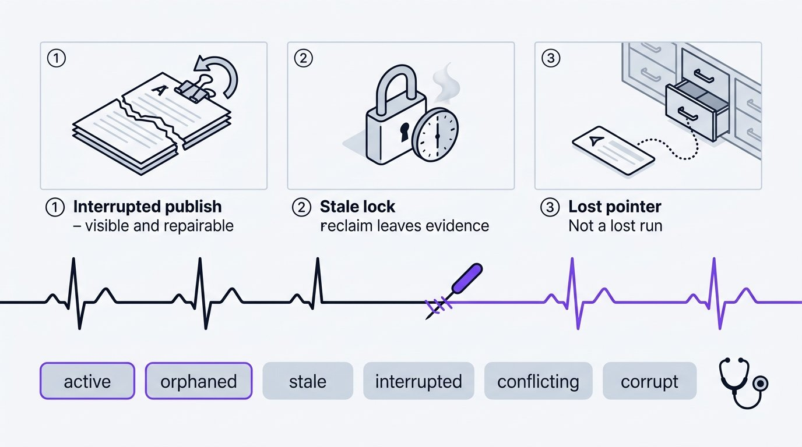

# Persistent Saves

Run state, deliverables, evidence and verdicts go to disk while a run executes,
so the next session resumes from evidence. Contract:
[`skills/save-protocol.md`](../skills/save-protocol.md).



## Layout

`skillset-saves/` lives in the project, never in the Supreme Team tree.

```text
skillset-saves/
  _latest.md                       # pointer: run_id, revision, updated_at
  _write.lock                      # writer mutex, held by the OS while save_run.py writes
  runs/{run-id}/
    _state.md                      # run state
    _lock.md                       # lock with heartbeat
    _audit-trail.md                # append-only events
    _journal.json                  # exists only mid-publish
    _history/                      # rev-<n>.state.json / rev-<n>.lock.json
    intake/report_grilling.md      # the hashed decisions artifact
    design/                        # one directory per phase
      manifest.json                #   the gate submission
      reports/  artifacts/  evidence/  packages/
      evidence/coverage/           #   coverage data and reports
      verdict_design-to-build.json #   the phase gate's verdict
      verdict_design-to-build.cross-stage.json  # gatekeeper-admiral's, beside it
      verdict_design-to-build.cycles.json       # the boundary's REVISE streaks; check.py --judgment --verdict-out
      verdict_design-to-build.cycles.lock       # its mutex
    build/  review/  security/  investigation/  qa/  taste/  redesign/  skill-creation/  release/
    delivery/reports/              # handoff_<boundary>.md and delivery-package.md
```

Evidence binds to source by `path` plus `sha256`; a changed source fails the gate
as `input hash drift`. Hashes fold text line endings to LF;
`python skills/scripts/content_hash.py <path>` prints one.

## One writer per path

`session-memory` writes the run record only through
`skills/harness/hooks/save_run.py`. Each phase lead writes its phase directory. A
specialist writes only the artifact its delegation named. Gatekeepers write
verdicts and the boundary's REVISE cycle history, and never touch a submission. Policy:
[`save-ownership.yaml`](../skills/save-ownership.yaml) (paths) and
[`ownership.yaml`](../skills/ownership.yaml) (artifacts); `pre_tool_use.py`
denies direct writes to the core run files.

## Lifecycle

```bash
python skills/harness/hooks/save_run.py create     --run-id <run> --evidence <path>
python skills/harness/hooks/save_run.py checkpoint --run-id <run> --expect-revision <n> --evidence <path>
python skills/harness/hooks/save_run.py status     [--run-id <run>]
python skills/harness/hooks/save_run.py complete   --run-id <run>
python skills/harness/hooks/save_run.py recover    --run-id <run> --reason "<why>" [--rollback]
```

`create` needs at least one `--evidence` path and a run id of 1 to 128 letters,
digits, `.`, `_` or `-`, starting with a letter, digit or `_`; it runs a write,
read and delete probe, refuses while another run holds the session pin, whatever
the pointer says, naming each such run and its way out, and persistence is
active only once it returns `ok`. Checkpoint before every
delegation and at every returned boundary: each checkpoint snapshots the
previous revision into `_history/`, registers evidence hashes, refreshes the
heartbeat and publishes the lock and state as one revision behind
`_journal.json`, then the pointer and the audit event; if either of those fails,
the revision stays published and the result is `degraded`. `--drop-evidence <path> --reason <why>` retires a moved or
pruned path; a run keeps at least one.

An interrupted publish is `interrupted`; repair it with `recover --rollback`.
While the journal exists every other write to the run is refused.

Exit codes: 0 `ok`; 1 `refused`, a contract violation to resolve, never to work
around by hand-editing; 2 `degraded`, the write did not complete and its reason
says what was and was not published; 3 engine error, JSON on stderr. Read
`result` in the JSON before treating a 2 as degraded, because a mistyped option
is argparse's own exit 2.

## Locks and staleness

A lock records owner, status, session pin, revision and an ISO-8601 heartbeat.
Active state needs a pinned, held lock; terminal state an unpinned, released one.
A lock is stale when its heartbeat is older than 30 minutes or more than five
minutes in the future. Reclaiming one needs `recover --reason`, which records the
stale lock's path, heartbeat, owner and sha256 in the audit trail.

Every write holds the `_write.lock` mutex from reading the run to its last write
and re-checks the revision inside it; a stale `--expect-revision` is refused, and
the OS releases the mutex when its holder exits. With hooks registered, every hook
refreshes the heartbeat from real host activity, throttled to once every five
minutes, for the one coherent held run whatever the pointer says, and the write
rewrites a damaged pointer from that run; a hook waits a quarter second for the
mutex and skips rather than hold up the host, and never revives a stale lock.

On POSIX systems, records are readable by their owner alone. In a project
shared by two accounts, a record the second account cannot read is never
classified as missing: `access_denied` names the file whatever the
classification, which is `corrupt` where nothing decides first.
`access_denied` is carried by the records that may hold the session pin (the
pointer, a lock, a state beside a held lock); a state the account cannot read
beside a readable released lock is `corrupt` without `access_denied`, so
`create` is allowed. Completing or releasing the run only ends the first
account's claim: a closed run's records are owner-only too, so the second
account can create a run again only once those records are readable to it or an
account that may delete them has removed them; never overwrite them.

## What startup sees

`save_run.py status` (and the readiness diagnostic) classifies saved state as
`active`, `inactive`, `complete`, `stale`, `orphaned`, `conflicting`, `corrupt`,
`missing`, `uninitialized` or `unreadable`; `status --run-id <id>` also reports
`interrupted` while that run's `_journal.json` file exists, and names the next step.
A held run whose lock is fresh reinforces the session pin whatever the pointer
says, so beside a damaged pointer (`corrupt`) or a second held run
(`conflicting`) too, mid-publish or beside a directory where its journal
belongs as well, and so does a record carrying `access_denied` (it may be a
held run); `held_runs` in the result names each run that holds the pin, and
whether its lock is fresh. A directory where a record belongs is `corrupt` on
every platform (`<path> is a directory, not a file`). `_latest.md` is a
pointer, not the truth: when it is missing or stale, scan `runs/` before
concluding there is nothing to resume.

## Resume and rewind

On resume, verify pointer, lock, owner, revision, artifacts, hashes and evidence,
then continue from the next incomplete boundary. When upstream evidence changes,
rewind to the earliest affected boundary and invalidate only the verdicts that
depend on it; a verdict survives only when `check.py --prior` reports
`prior_reusable: true`.

## Repository hygiene

`skillset-saves/` and the coverage residue names (`.coverage`, `.coverage.*`,
`.coverage/`, `htmlcov/`, `.nyc_output/`) are local runtime state and stay in
`.gitignore`. Keep the saves to resume or audit a run; delete them when you mean
to discard that history.
